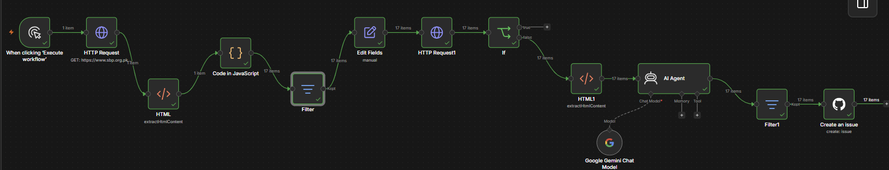

🚨 Autonomous Regulatory Compliance & Action Agent (FinTech)
An autonomous, event-driven data ingestion and compliance pipeline that monitors central bank portals, evaluates legal updates using LLMs, and flags technical system risks directly to engineering Kanban boards.

💡 The Problem
FinTech platforms, Electronic Money Institutions (EMIs), and digital banks operate in tightly regulated environments. When central banks (like the State Bank of Pakistan) issue updates, policy shifts regarding KYC frameworks, digital wallet limits, or transaction compliance must be analyzed immediately.

Manual tracking results in thousands of overhead hours, data silos, and a high risk of systemic regulatory non-compliance. This project automates the entire lifecycle from legal release to engineering ticket assignment.

🏗️ System Architecture
The workflow is built entirely using declarative visual programming and AI orchestrations.

Plaintext
[Cron / Trigger] ──> [HTTP Request/Scraper] ──> [HTML Text Extractor]
                                                       │
                                                       ▼
[GitHub Kanban Board] <── [Filter: CRITICAL] <── [Advanced AI Agent (Gemini)]
Place your workflow canvas screenshot right below this line to visually show off the node pipeline!

🛠️ Tech Stack & Core Concepts
Orchestration Engine: n8n (Advanced AI / LLM Workflow Automation)

AI Engine: Google Gemini (Via Google AI Studio API Framework)

Data Scraper: Node-based HTML DOM Parser & Selector Layer

Infrastructure & Ticketing: GitHub Issues / REST API v3 Integration

Key Engineering Concepts Demonstrated: Real-time Web Scraping, LLM Prompts Engineering, Deterministic Filtering, Automated DevOps Workflows, Event-Driven Architecture.

📂 Core Pipeline Stages
1. Web Extraction Layer
An extraction phase monitors target URLs, capturing dynamic structural updates. Custom class filtering blocks out website navigation elements (footers, headers, links) to deliver cleanly isolated raw string payloads to the processing queue.

2. Autonomous Analysis Engine (LLM Agent)
The extracted legal text is piped into an Advanced AI Agent node powered by Gemini. Operating under targeted system prompt guardrails, the agent reads the document context and checks for legal changes targeting:

Digital Wallets / EMIs

AML/KYC Regulations

Transaction & Daily Transfer Limits

The model extracts the main technical components and automatically classifies the issue urgency level into: CRITICAL, MEDIUM, or LOW.

3. Criticality Filter
A conditional logical filter inspects the metadata returned by the AI agent. If the update is classified as CRITICAL, the payload passes to the action phase. Minor or purely administrative notices are filtered out to protect development queues from spam.

4. Downstream Action (GitHub Project Automation)
High-priority alerts communicate directly with the GitHub Rest API, generating structured issue tracking tickets filled with markdown context. This auto-populates the engineering Kanban board's To Do column for immediate software update deployment.

🚀 How to Import and Run This Project
Because n8n utilizes declarative JSON schemas to define architecture, you can spin up this entire infrastructure in less than 60 seconds:

Clone this repository or copy the contents of sbp-compliance-agent.json.

Open your n8n instance.

Click on the top-right menu icon and select Import from File.

Upload sbp-compliance-agent.json.

Link your Google AI Studio API Key to the Gemini Chat node and your GitHub Personal Access Token to the GitHub node.

Click Execute Workflow.